# Yodacon — feature guide

A tour of the game in pictures: one trader's round trip from the menu to the burning sky and back to orbit, what each part is, why it exists, and how it fits the whole. The game is **Gonex**, the `gonex/` submodule; this repository is the yodacon centre that recovers the 1997 ConEx plugin and feeds it to the game.

> **Where the pictures come from.** None of them was captured for this guide. Gonex draws through Ebitengine and needs a real window, and this machine has no headless display, so every picture is one the repo already holds, photographed from the running build with the game's own frame dump (`GONEX_SHOT`) or flight recorder (`GONEX_REC`): the flight manual's screens in [`docs/game/img/`](game/img/) (22 September 2026, seed `20260922`), the cockpit captures in [`assets/gpis-instruments/`](../assets/gpis-instruments/) and [`assets/governor-desk/`](../assets/governor-desk/), and two stills from the recordings in [`assets/`](../assets/) (pixel-doubled from 512×384). [`tools/feature-guide.sh`](../tools/feature-guide.sh) copies them into [`docs/features/`](features/) and burns in the numbered markers the captions refer to. Screens from different captures show different days (0, 120, 150, 300); they are one build, not one session.

For the player's reference card see the [Pilot's Guide](../gonex/docs/PILOT-GUIDE.md); for every screen with the economy drawn under it, the [flight manual](game/index.html); for the arguments and measurements, the [lab reports](lab-reports/).

## Contents

1. [Three generations of one game](#part-1)
2. [Start a trader](#part-2)
3. [The flight map: lanes, fleets and the power grid](#part-3)
4. [Landing is never a keypress: deorbit](#part-4)
5. [The reentry corridor](#part-5)
6. [The instruments teach the physics](#part-6)
7. [The wager: flying it badly](#part-7)
8. [Final, beside a seed-grown town](#part-8)
9. [The debrief: the landing is the score](#part-9)
10. [The concourse](#part-10)
11. [The commodity board](#part-11)
12. [Missions: the 1997 machine, running again](#part-12)
13. [The bar: escorts and crew](#part-13)
14. [The outfitter: mass with consequences](#part-14)
15. [The shipyard: the road to the Yodacon](#part-15)
16. [The trade journal: a galaxy that trades while nobody is looking](#part-16)
17. [The Governor's Desk](#part-17)
18. [Takeoff: the landing backwards, and quicker](#part-18)
19. [What is not built yet](#part-19)
20. [How it fits together](#part-20)

## 1. Three generations of one game

**Why it exists.** The Yodacon was a starship rendered for a middle-school home-room contest that it lost; it was published in **ConEx**, Paul Richeson's plugin for Ambrosia's *Escape Velocity*. The project gives the ship a purpose again: revive ConEx and expand it into a commodity-trading game whose signature system is the landing.

**How it fits.** Everything in this guide stands on that lineage, and much of it is the 1997 data itself.

| Year | Name | Form | What it kept |
| --- | --- | --- | --- |
| 1997 | ConEx 1.2 | an Escape Velocity plugin: 538 resources in a Mac resource fork, no code | ships, missions, systems, landing pictures |
| 2005 | konex | Joshua Bussdieker's C++/OpenGL remake | ConEx's cast and splash screen; only deathmatch and "Sunday Drive" |
| 2026 | Gonex | the Go/Ebitengine port | konex's engine, ConEx's game restored, and a new reentry-trader layer |

The lineage report puts it in one line: konex kept ConEx's cast and dropped its game; Gonex kept konex's engine and restored ConEx's game ([LR, 28 Aug](lab-reports/2026-08-28-conex-konex-gonex-lineage.md)).

The yodacon repo is the chain that makes that true. `make verify` proves `evutils` dumps the 1997 resource fork and rebuilds it **byte-identically**; `make export` writes the gazetteer, missions, ships and landing art into the game; `make gonex` builds it and `make run` flies it. New missions are written as plain text in `campaign/` and checked by the `yodaed` question queue (`make check`).

## 2. Start a trader

**Why it exists.** konex's menu offered two lives, deathmatch and a drive. The commodity game needed a third that starts poor, in an armed world.

**How it fits.** Trader loads the same three-colour world as Team Deathmatch, so the lanes are live and dangerous, and stakes the pilot 8,000 cr on margin. The opponent that matters, though, is the atmosphere.

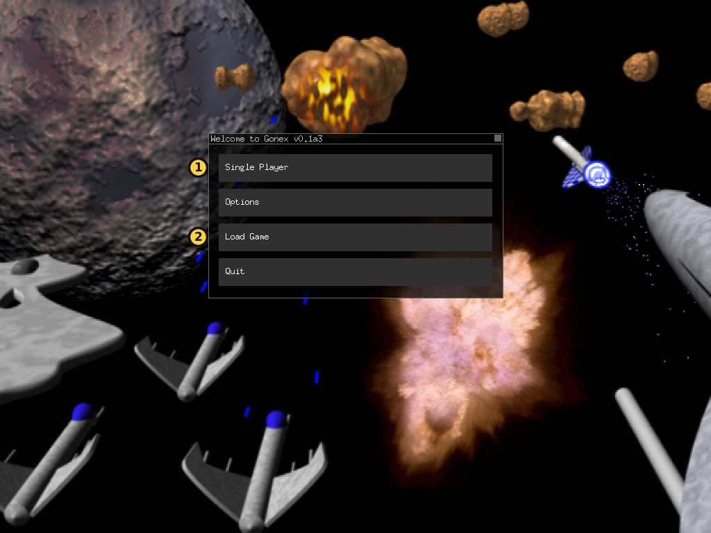

*The main menu (Gonex v0.1a3).*

1. Single Player → Team Deathmatch (konex's original three-way), Sunday Drive (no opposition), **Trader** (the campaign this project added).
2. Load Game: resume from the last save. Escape toggles the menu, and the game pauses behind it.

## 3. The flight map: lanes, fleets and the power grid

**Why it exists.** You need to get between ports, and the ports are worth trading between because the galaxy around you is busy: three colours flying fleets with a doctrine and a phase (muster, advance, engage, withdraw, return to base).

**How it fits.** The flight view is konex's top-down arena, unchanged in feel. What is new is the course: `M` charts a route over the recovered 1997 hyperspace links, you fly to the warp beacon, and `J` jumps. Every jump costs 100 fuel and three days, and those three days are three days of trade for everyone else. The chart is the way out of a fight, not the guns.

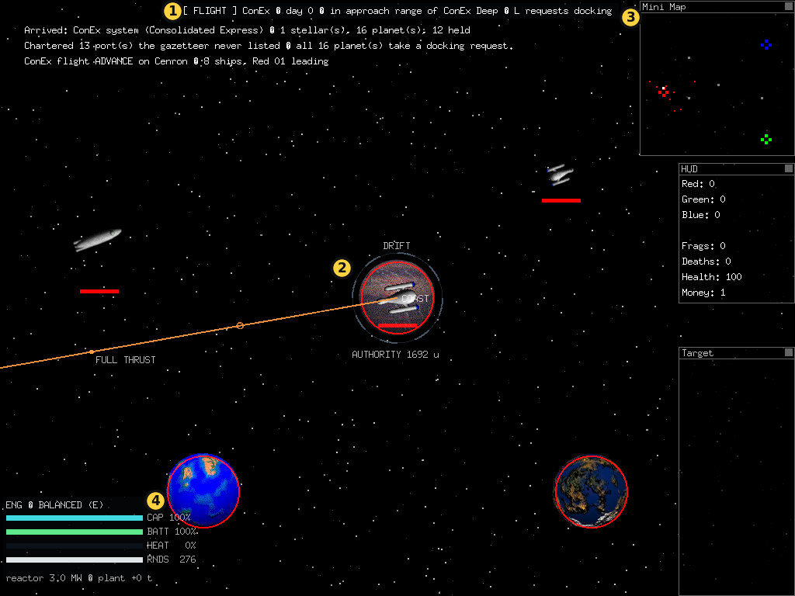

*The flight view at ConEx, in approach range of a planet.*

1. The mode banner: system, day, and *in approach range · L requests docking*.
2. Your ship, with the orange docking approach vector.
3. The mini map: the three colours' fleets (red, green, blue).
4. The power grid: capacitors, battery, heat, rounds, reactor megawatts. It is the one machine every mode in the game is secretly operating; flight, battle, warp, entry and the pad differ only in which loads are screaming.

Controls: arrows turn and thrust, Space fires, X brakes, Shift targets, Tab is the full map, `` ` `` is the developer console.

## 4. Landing is never a keypress: deorbit

**Why it exists.** In Escape Velocity a landing was a click. Here it is the game: *you do not press "land", you fly it down.*

**How it fits.** `L` near a planet hails control; after a beat you are given a pad and a 30-second clearance window. `L` again commits the deorbit burn, and orbital mechanics hand straight off into the corridor at the 122 km entry interface, with no cut.

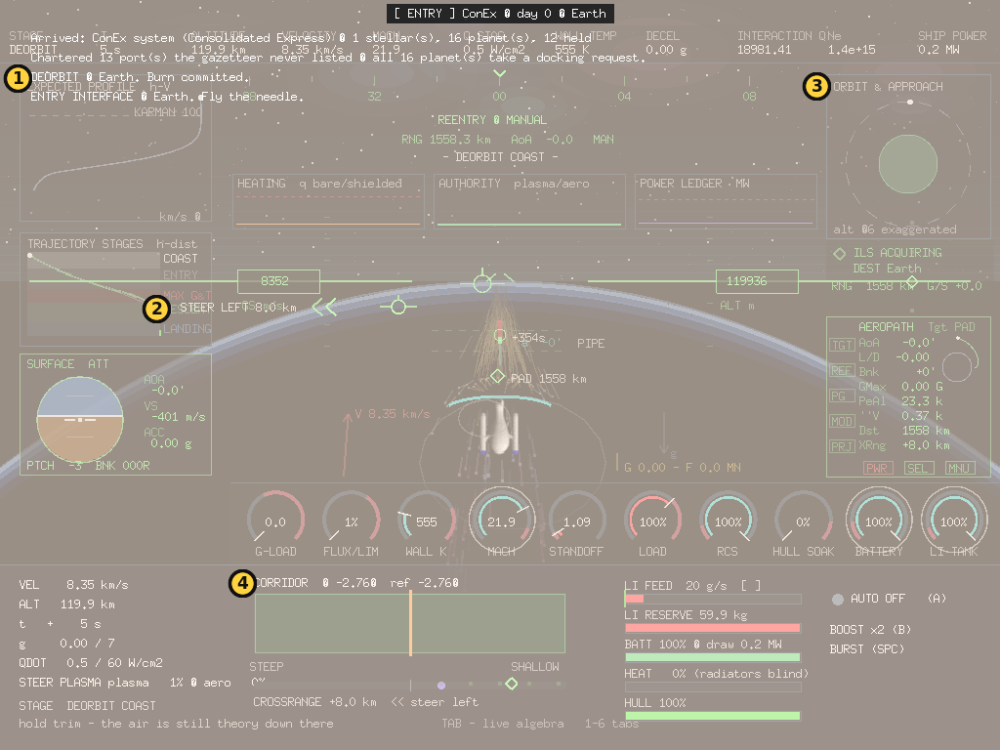

*The deorbit coast, 119.9 km above Earth, hands off the stick.*

1. *DEORBIT · Earth. Burn committed.* then *ENTRY INTERFACE · Earth. Fly the needle.*
2. Already 8 km off the pad line: STEER LEFT, with chevrons.
3. ORBIT & APPROACH: the planet, the parking orbit you left, and the descent spiralling in (altitudes exaggerated).
4. The corridor gauge, still empty; the air is theory up here.

## 5. The reentry corridor

**Why it exists.** A 350-tonne freighter has the ballistic coefficient of a falling anvil. What makes it flyable is a **magnetohydrodynamic plasma aeroshell**: the nose coil makes the hull a dipole, the bow wave ignites into plasma, and the magnetic bubble stands the shock off and sheds the heat. Lithium seed keeps the shock layer ionised. That is the ride: as long as the sheath stays lit, the heat stays off the hull.

**How it fits.** This is the piece the project is really about. Every number on the screen is computed from the flow state, not a table, and every outfit you buy, every tonne of cargo, changes it.

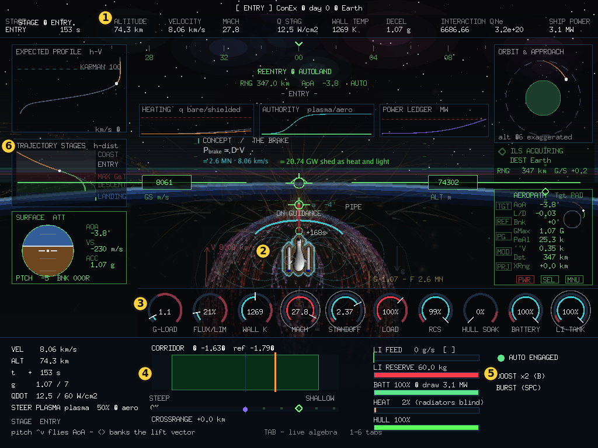

*Reentry over Earth with autoland engaged: 74.3 km, 8.06 km/s, Mach 27.8.*

1. The telemetry strip: altitude, velocity, Mach, stagnation heat flux, wall temperature, deceleration, the magnetic interaction parameter, electron density, ship power.
2. The ship inside the pillow, drawn as it is modelled: plasma sheath, dipole field lines, shock.
3. The dial cluster: G-load, flux against limit, wall temperature, Mach, magnetopause stand-off, load, RCS, hull soak, battery, lithium tank. Each has its red zone.
4. The corridor gauge: too steep burns, too shallow skips out, and the caret is the line the debrief pays out on.
5. AUTO ENGAGED. `A` toggles autoland; `B` boosts the coil, Space bursts.
6. TRAJECTORY STAGES: the flown trace over this seed's expected profile.

Pitch flies the angle of attack, `<` `>` bank the lift vector, `[` `]` set the lithium feed. Rolling tilts the dipole and hardens the mirror on the side opposite the turn: that bright lobe is the rudder. As the ship slows the sheath cools and plasma authority hands over to aerodynamic control (STEER PLASMA / AERO); the console calls it *"We're in the pipe, five by five."*

## 6. The instruments teach the physics

**Why it exists.** The physics is only a game if the player can read it. The descent is taught in six stages from *Go Play In Space*, chapter 6: deorbit, entry, peak g, skip, descent, landing.

**How it fits.** The stage is classified from the live simulation every frame, and everything follows from it: which dials are ringed, which band of the chart is lit, what the hint line says. Tab lays the console's algebra on the sky, recomputed from the simulation, one tab per stage.

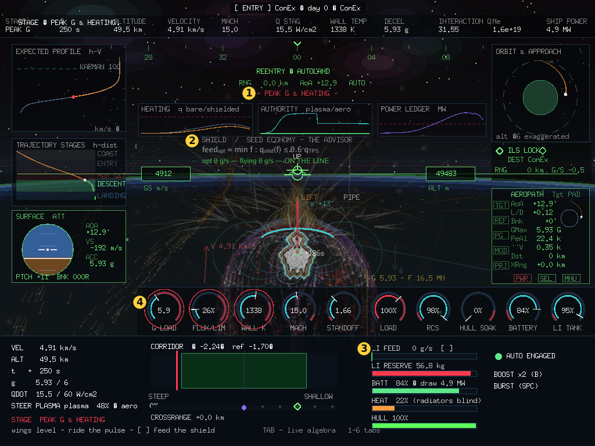

*Peak g and heating at 49.5 km, autoland, with the SHIELD tab on the sky.*

1. The stage, classified live: PEAK G & HEATING.
2. The algebra on the sky: the seed-economy advisor, `feed_opt = min f : q_shld(f) ≤ 0.6·q_TPS`, the least lithium that holds the heat line. *opt 0 g/s, flying 0 g/s, ON THE LINE.*
3. The lithium feed, reserve, battery, heat and hull bars.
4. The ringed dials: in this stage G-LOAD, FLUX and WALL K are where to look.

## 7. The wager: flying it badly

**Why it exists.** The arcade score of konex's deathmatch was moved from combat to the environment. Every descent is a press-your-luck round with a visible pot: the pad bonus pays in full inside 2 km of the line and half inside 10; the corridor's edges charge hull; staying supersonic low triggers a sonic-boom fine. Lithium, coil boosts and RCS are chips you spend or hoard.

**How it fits.** Heat is the currency. Repairs, spoiled cargo (clamps over 50% damage spoil the freight), a degraded flight computer and the guardian dumping seed reserves are all paid in it. The guidance fights for the pilot, and the debrief signs for everything.

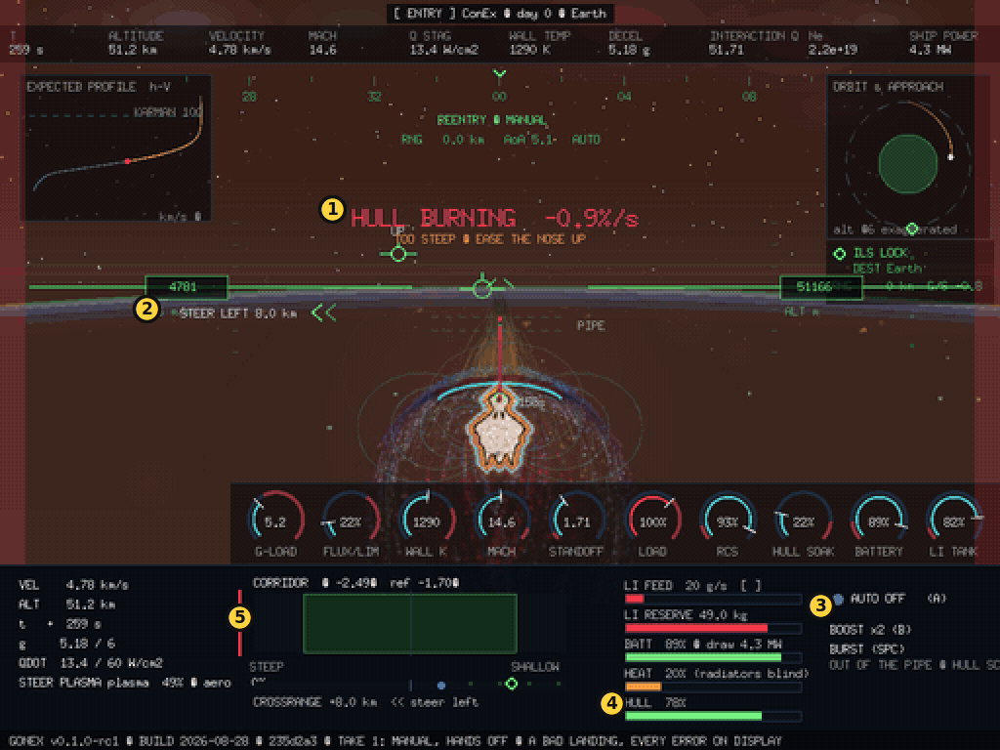

*Still from `assets/landing-a3-manual.gif`: the same corridor flown hands off on purpose (build 2026-08-28).*

1. HULL BURNING −0.9 %/s; TOO STEEP · EASE THE NOSE UP.
2. STEER LEFT 8.0 km: the crossrange nobody corrected.
3. AUTO OFF (A): nobody is flying.
4. Hull at 78% and falling.
5. The corridor gauge's steep edge, lit red.

This take ends in an **E**, *WRITE-OFF*. When the corridor wins outright (hull to 100% in the plasma, or arriving at the deck too hot) the screen says **DED**, and any key resumes from the last berth save.

## 8. Final, beside a seed-grown town

**Why it exists.** Interface is at 122 km and the pad is a 2 km line: five decades in one camera. The landing camera thinks in log-altitude tiers (planet limb, shorelines, city lights, terrain, the pad), so the scale reads.

**How it fits.** Every stellar grows its own port town from its seed, the same town forever, on one side of a spaceport road laid like a runway. That road *is* the pad line. You land and take off next to the same city.

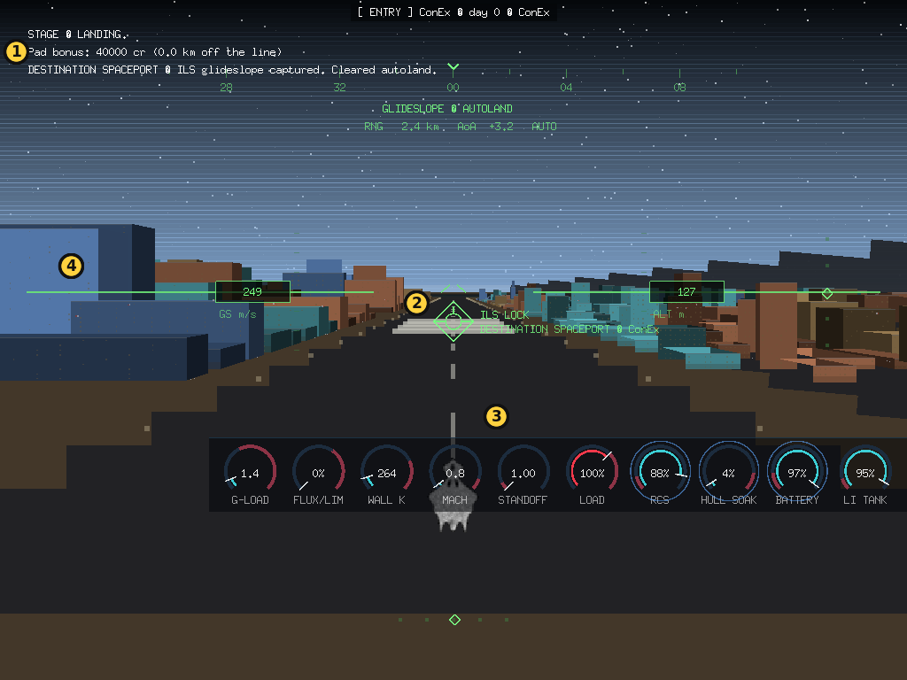

*Glideslope, autoland, on final into ConEx at 127 m.*

1. *Pad bonus: 40000 cr (0.0 km off the line)* and *ILS glideslope captured. Cleared autoland.*
2. ILS LOCK on the destination spaceport.
3. The spaceport road: the pad line, centreline and all.
4. The seed-grown town, built on one side of the road.

## 9. The debrief: the landing is the score

**Why it exists.** The corridor teaches during the descent; the debrief is where the lesson is signed. It turns the flight into money and a grade.

**How it fits.** The score is 100, less hull, computer and clamp damage, crossrange, time outside the pipe, emergency recoveries and a boom fine, plus 5 for landing inside 2 km. A+ to E, each named in the company's ledger language.

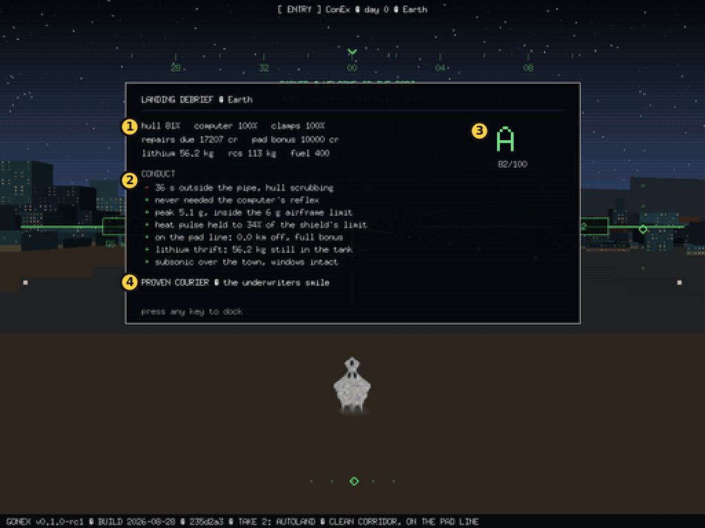

*Still from `assets/landing-a3-auto.gif`: the clean autoland (build 2026-08-28).*

1. What it cost and earned: hull 81%, repairs due 17,207 cr, pad bonus 10,000 cr, lithium and RCS left.
2. CONDUCT: what was flown well (green) and what was paid for (red): 36 s outside the pipe, peak 5.1 g inside the 6 g limit, 0.0 km off the pad line, subsonic over the town.
3. The grade: **A**, 82/100.
4. *PROVEN COURIER · the underwriters smile.*

Every touchdown also costs a day and writes the berth save automatically.

## 10. The concourse

**Why it exists.** Escape Velocity's spaceport was a menu of places. Gonex keeps that shape and puts the economy behind every door.

**How it fits.** It is the hub between two flights. Escape from any sub-screen returns here.

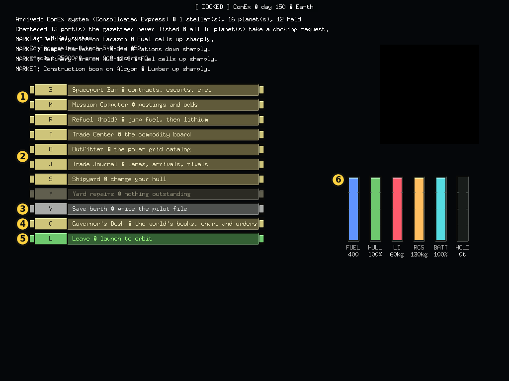

*Docked at Earth, day 150.*

1. Spaceport Bar (B) and Mission Computer (M): work.
2. Refuel (R: jump fuel first, then lithium), Trade Center (T), Outfitter (O), Trade Journal (J), Shipyard (S); Yard repairs (Y) when there is damage.
3. Save berth (V): write the pilot file by hand.
4. Governor's Desk (G).
5. Leave (L): launch to orbit.
6. The ship's state: fuel, hull, lithium, RCS, battery, hold.

## 11. The commodity board

**Why it exists.** This is a commodity game: buy low here, haul, sell high there.

**How it fits.** The board is a window onto a simulation, not a price table. Price is cover, how many days of real demand the warehouse holds: a short world pays up to 3×, a glutted one as little as 0.35×, and a producer sells cheap, which is what gives a route its direction. IN PORT is a real warehouse that runs out.

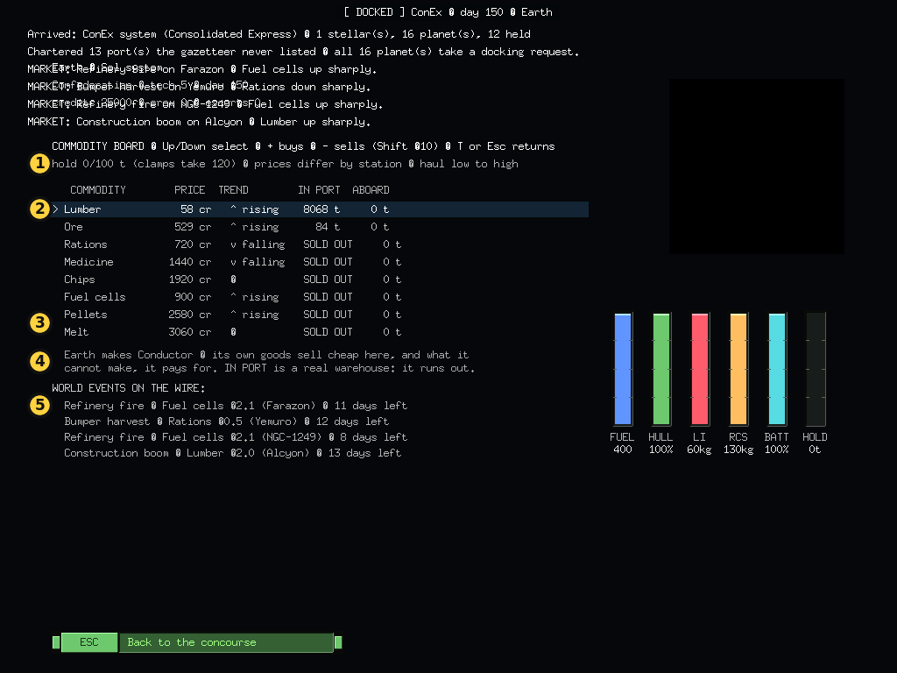

*The board at Earth, day 150. Up/Down selects, + buys, − sells, Shift ×10.*

1. Your hold: 0/100 t; prices differ by station.
2. Lumber at 58 cr with 8,068 t in port: Earth makes it, so it sells cheap here.
3. Pellets 2,580 cr and Melt 3,060 cr, both sold out: the two lithium fuels, and a fuel famine visible at a counter.
4. *Earth makes Conductor: its own goods sell cheap here, and what it cannot make, it pays for.*
5. World events on the wire: a refinery fire, a bumper harvest, a construction boom, each moving a price for some days.

The eight board goods are the first eight of thirty materials in six tiers (crust, refined, board, yard, returns, slag). Every ton was put in the ground at genesis and can only move; every credit was minted at genesis. An auditor checks both totals every day.

## 12. Missions: the 1997 machine, running again

**Why it exists.** ConEx's life was its missions: 36 records on Escape Velocity's 512-bit control machine, including an in-fiction flight academy. Gonex is the first program since Escape Velocity itself to run that data.

**How it fits.** The mission computer lists every posting whose GIVEN clause matches this port and your record, with its pay and its daily chance. The bar is who actually walked in today: once per landing each eligible posting rolls its 1997 `AvailRandom` percentage. The original academy chain runs unmodified; the **Approach School** (missions 300–309) forks it after Trading 202, *instead of* Start Combat Training, and teaches the corridor, heat, the handoff, and one hull doctrine at a time, ending on the Yodacon.

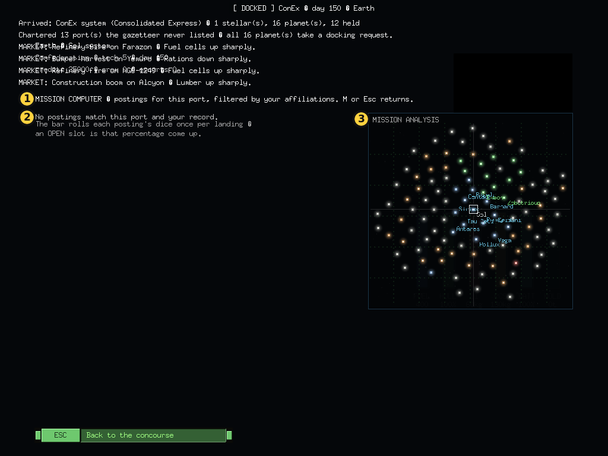

*The mission computer at Earth, day 150. In this capture nothing matched.*

1. Postings for this port, filtered by your affiliations (the control bits your past missions set).
2. *No postings match this port and your record.* The bar rolls each posting's dice once per landing.
3. MISSION ANALYSIS: the chart of the galaxy the postings point into.

## 13. The bar: escorts and crew

**Why it exists.** The lanes are armed, and a courier can buy protection instead of fighting.

**How it fits.** Escorts cost a hire fee plus a daily wage, crew a smaller wage, and payroll walks on every jump and landing: wages are a position you carry.

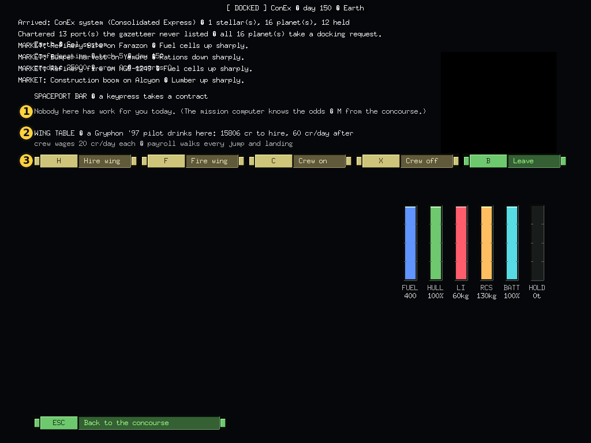

*The bar at Earth, day 150.*

1. Today's contracts: a keypress takes one. Nobody has work today.
2. The wing table: a Gryphon '97 pilot drinks here, 15,806 cr to hire and 60 cr a day after; crew wages 20 cr a day each.
3. Hire (H) and fire (F) the wing, sign (C) and dismiss (X) crew.

## 14. The outfitter: mass with consequences

**Why it exists.** Upgrades in most space games are free power. Here *every tonne raises the ballistic coefficient on entry*: what you bolt on, the atmosphere charges you for on the way down.

**How it fits.** Twelve items on one power grid. Two ladders sit on top of it. The **reactor** ladder decides which of the two fuels the hull accepts (a thermal pile burns Pellets; a sodium fast loop or a breeder burns Melt), so the reactor decides which refineries in the galaxy are your suppliers. The **confinement** ladder holds the reentry pillow; since stand-off grows only as the sixth root of magnetic pressure, each rung fixes one distinct failure instead of buying more field.

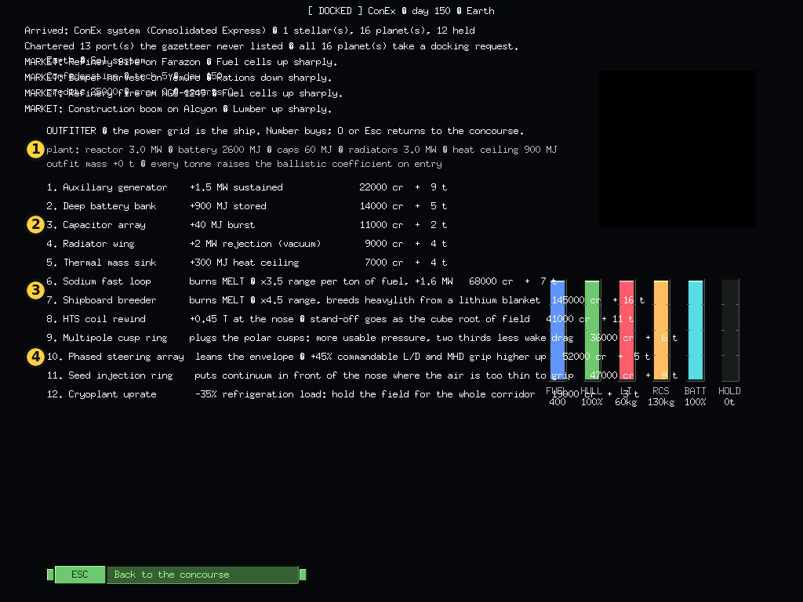

*The outfitter at Earth, day 150. Number buys.*

1. The plant: reactor 3.0 MW, battery, capacitors, radiators, heat ceiling; outfit mass +0 t.
2. Power grid (1–5): generator, battery bank, capacitor array, radiator wing, thermal mass sink.
3. Reactors (6–7): sodium fast loop (×3.5 range per ton of fuel), shipboard breeder (×4.5, breeds heavylith from a lithium blanket).
4. Confinement (8–12): HTS coil rewind (too little field), multipole cusp ring (a bottle that leaks at the poles), phased steering array (a pillow with no steering), seed injection ring (air too thin to grip), cryoplant uprate.

The long rows run under the gauges; that is a known visual bug, listed in the [flight manual](game/README.md#known-visual-bugs).

## 15. The shipyard: the road to the Yodacon

**Why it exists.** In this universe the hero is a courier, and the campaign is earning your way up the hulls until the master ship is yours.

**How it fits.** Each hull's numbers are the lesson: velocity is deadline reach, mass is what the atmosphere charges, turn and acceleration are pad work. Thirteen hulls: konex's own, and the 1997 roster marked '97, drawn from nine sprite banks recovered from the plugin.

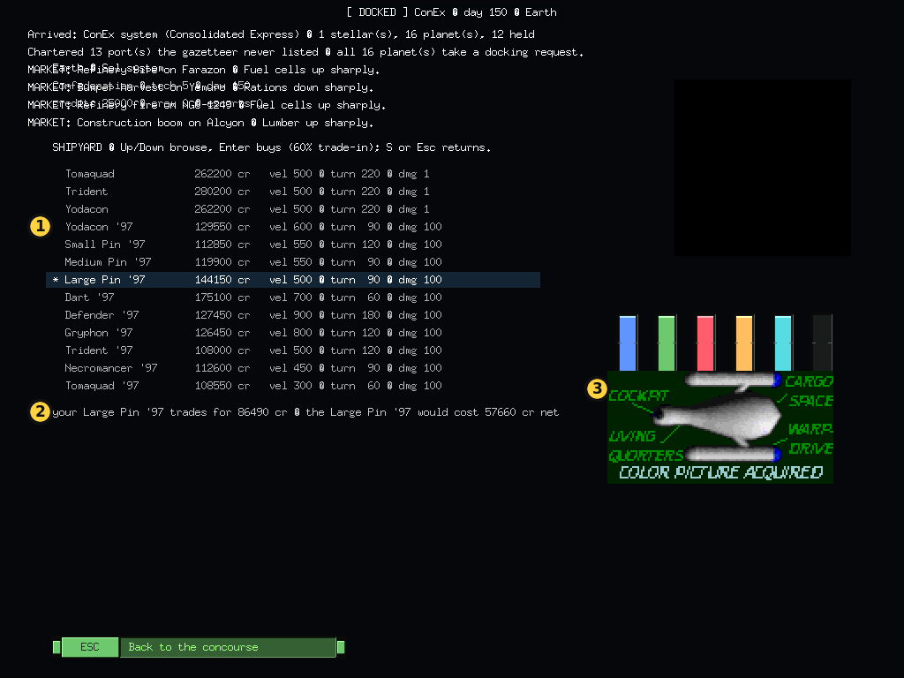

*The shipyard at Earth, day 150. Enter buys at a 60% trade-in.*

1. The **Yodacon '97**, exactly as it shipped in ConEx: its sprite rotations decoded from the plugin's resource fork (PICT 20617 and its mask).
2. The trade: your Large Pin '97 trades for 86,490 cr.
3. The 1997 shipyard picture, recovered from the plugin.

## 16. The trade journal: a galaxy that trades while nobody is looking

**Why it exists.** A courier needs to know where the money is today, and the answer has to be a consequence of the simulation, not a fixture.

**How it fits.** 109 ports dig, refine, eat, grow and trade, with about 195 hulls carrying the difference, whether you are looking or not. Off-screen hulls are real ships with momentum (a full hauler accelerates worse), routes are found from what ports are paying, and a hull trades only with its own colour and neutrals.

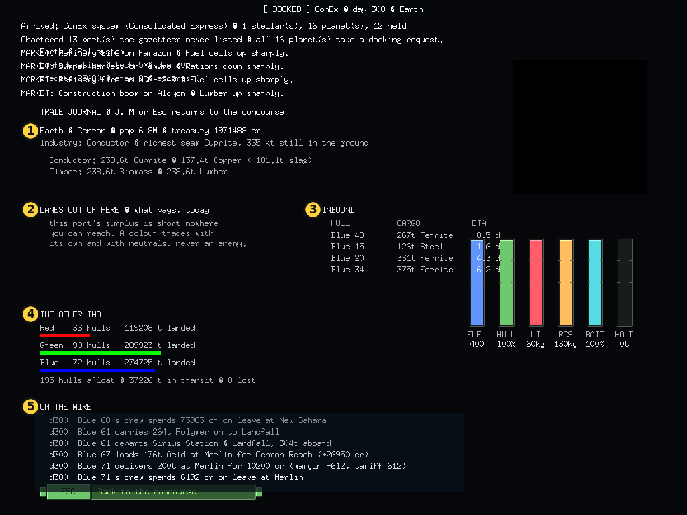

*The trade journal at Earth, day 300.*

1. This world: population, treasury, industry and its richest seam.
2. Lanes out of here, and what pays today.
3. Inbound hulls with cargo and ETA.
4. The other colours: hulls afloat and tons landed.
5. On the wire: every load, delivery, tariff and shore leave in the galaxy as it happens.

## 17. The Governor's Desk

**Why it exists.** ConEx was always two games in one hull: a commodity trader and a territorial government fighting for worlds. The desk is where a player who has bought into a world stops being a courier and starts being a colour.

**How it fits.** The first building at a world is its charter; hold it and the desk is writable, otherwise you watch someone else govern. Every effect is a change to a number the simulation already reads.

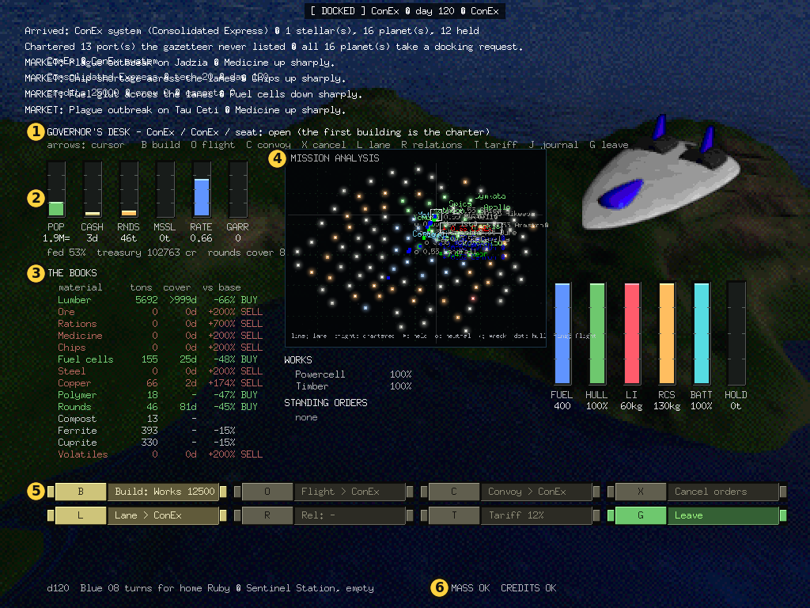

*The desk at ConEx, day 120, over the 1997 landing picture.*

1. *seat: open (the first building is the charter)*.
2. The world: population, cash, rounds, missiles, rating, garrison.
3. THE BOOKS: each material's tons, days of cover, and price against base.
4. The chart: the galaxy, colour-coded, with lanes, charters, wrecks and flights.
5. Orders: build, send a flight or a convoy, charter a lane, set the tariff.
6. MASS OK · CREDITS OK: the conservation audit, on screen.

## 18. Takeoff: the landing backwards, and quicker

**Why it exists.** The round trip has to close: after the pad, the lanes.

**How it fits.** `L` on the pad rolls you down the same spaceport road like an airport departure, over the same town, up through the ascent sheath to orbit, escorts on the wing. Twelve seconds against the entry's hundred.

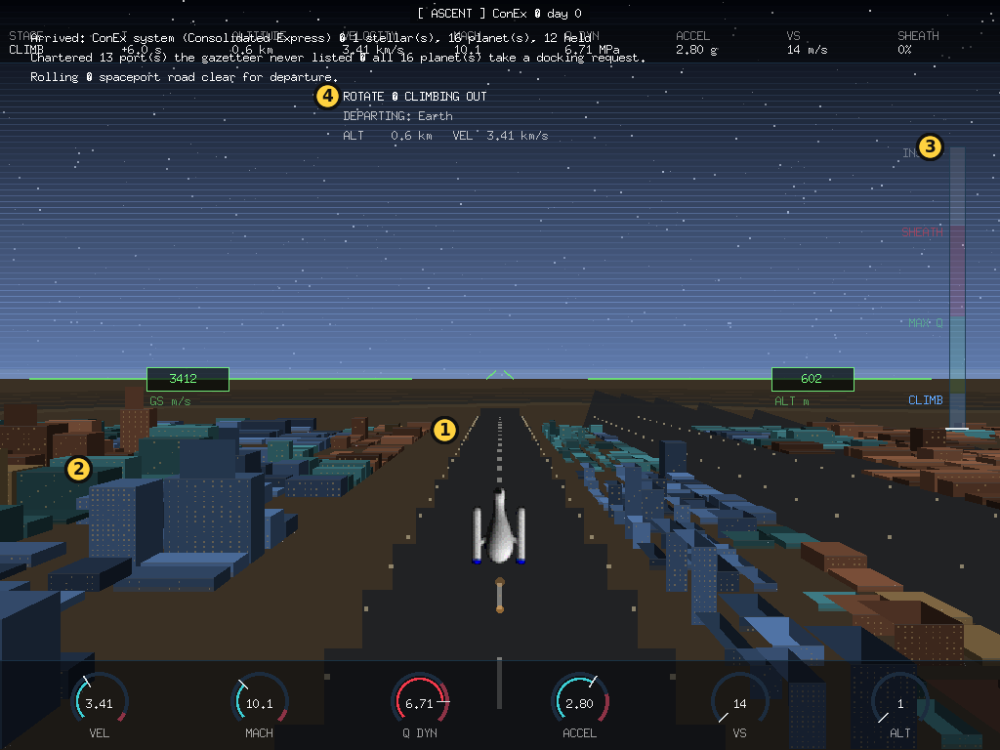

*Rotate, climbing out of Earth at 0.6 km and 3.41 km/s.*

1. The spaceport road you landed on.
2. The same seed-grown town.
3. The ascent stages: CLIMB, MAX Q, SHEATH, INSERT.
4. ROTATE · CLIMBING OUT.

The whole round trip is on tape in the repo: [`assets/reentry-a3.gif`](../assets/reentry-a3.gif) and [`assets/takeoff-a3.gif`](../assets/takeoff-a3.gif) (v0.1a3), listed in [`assets/RECORDINGS.md`](../assets/RECORDINGS.md).

## 19. What is not built yet

Stated as plainly as the [mechanics overview](lab-reports/2026-09-22-game-mechanics-overview.md) states it:

- **Fuel is not yet a jump consumable.** Pellets and Melt are traded and eaten, but a hull's own jump does not burn them, so the reactor ladder's range is a shop label rather than a constraint.
- **One world per system.** The recovered gazetteer has one stellar in each of its 109 systems, and the measured economy is starved of chips, hull plate and fuel because of it. Three bodies per system (planet, station, nebula) is the planned fix.
- **The transmutation core and the energy economy** are design only.
- **Art.** Nothing added in the last two passes has a sprite: no commodity, outfit or building icons yet.

## 20. How it fits together

**Why it exists.** The game is one loop: land, take contracts, outfit, launch, jump the lanes, land again. Credits buy hulls, escorts and a power grid; the atmosphere charges for every tonne of it on the way back down.

**How it fits.** Each part exists because the part before it is not enough on its own.

| Stage | Feature | Why it is not enough alone |
| --- | --- | --- |
| Inherit | ConEx data, byte-exact; konex's engine | A recovered plugin and an arena are not a game until something gives the ships a reason to fly. |
| Earn | Mission computer, bar, Approach School | Contracts say where to go, not whether you can get down there. |
| Trade | Commodity board, journal, the audited economy | A margin on the board is only money once the cargo is on the ground. |
| Equip | Outfitter, shipyard, escorts | Every tonne and every hull raises the price of the next entry. |
| Travel | Flight map, chart, warp | Jumps cost fuel and days, and the market moves while you fly. |
| Land | Deorbit, corridor, six-stage instruments | The physics charges heat for arriving; flying it well is the skill. |
| Settle | Debrief, pad bonus, repairs, DED | Turns the landing into a score and the score into credits, and back to the board. |
| Govern | The Governor's Desk | When couriering is not enough, buy into a world and play the colour. |
